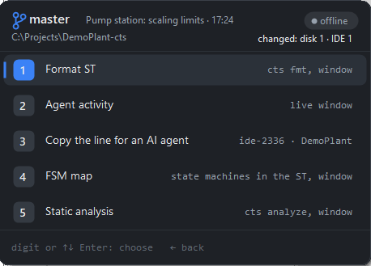
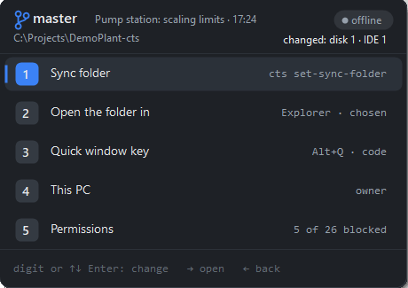

# Script Overview

What the tool offers inside CODESYS, in the order you use it. After
[installation](install.md) it has one menu entry, **Tools > Scripting > Scripts >
C > cds-text-sync**, and the same command as a toolbar button; both start the
in-IDE agent and open the quick window (Alt+Q), where everything below lives.
Each action also has a `cts` equivalent for shell and CI use; run `cts --help`
and `cts <command> --help` for the installed CLI reference.

## 1. The sync folder (setup)

**Set it first.** It links your current CODESYS project to a folder on disk,
a git repository. With the agent running (`cds-text-sync.py`), press Alt+Q,
then `8` Settings and `1` Sync folder; `cts set-sync-folder PATH` does the same
from a shell.

- On a project without one, the row's line already holds a folder named after
  the project (`./MyProject-cts`) beside the `.project` file. Enter accepts it,
  and the line is editable. Once set, the same row opens Explorer's folder
  dialog to move it.
- A relative path starts at the folder of the `.project` file; `.` is that
  folder itself. The folder is created when it does not exist.
- The project finds its folder by its id, not by a path. It gets an id
  (`cts-project-id` in Project Information, the one field cts keeps in the
  `.project`), the folder's `cds-text-sync.json` names the same id, and this PC
  remembers where the folder is (`%LOCALAPPDATA%\cds-text-sync\projects.json`).
  A copy of the `.project` opened from anywhere finds the folder again; on
  another PC, the project has no sync folder until it is set once there, for
  that PC's clone of the repository.
- The PC that gives the project its id is its owner: the one that publishes
  the project file into the repository (`cts commit --publish`).
- On a folder that has no `cds-text-sync.json` yet, it writes one with the
  settings in effect (your user defaults over the built-in ones).
- Makes the folder a git repository root: a
  folder without a repository gets `git init`, a `.gitignore` for what cts and
  CODESYS generate there (`.cts-docs/`, the `.project`'s lock, option
  and build files), a `.gitattributes` that keeps native `.xml` objects out of
  line merges, the `cds-text-sync.json` above, and a first commit of those
  files. A folder that is already
  a repository root only gets the missing lines, uncommitted. A folder inside
  another repository, not at its root, is refused: the sync base
  needs the repository root to be the sync folder.
- The selected sync root is then resolved into the editable view root such as
  `project-view/`. cts keeps its temporary files under the repository's
  `.git/cts/`, never in the working tree.

**Examples**:

- Absolute path: `C:\MyProjects\MyPLC\sync\`
- Relative path (project directory): `./`
- Relative path (subfolder): `./sync/`

## 2. Active sync commands

The menu has one entry, `cds-text-sync.py`; it starts the agent and opens the
quick window. The installer also registers `cds-text-sync` in the sibling
CODESYS Script Commands folder, with its script and icon, and adds its button
() to the Standard toolbar. If CODESYS was open during setup, close it and
run `cts install --toolbar`. The button does the same as the menu entry.
Export, import, compare and build (`cts build`) are `cts` commands (section 6).

### The quick window

Alt+Q in CODESYS (while its window has the focus; other programs keep their
Alt+Q) opens the quick window over the IDE. Opening it runs only reads
(`cts compare`, git branch/log, and a git fetch at most once a minute); nothing
changes until a command is chosen.

- **No project open**: the known projects, opening any `.project` file, and
  Settings for user-level tools and the quick key.
- **Header**: the work branch (`↑N ↓M` when it is N commits ahead of its
  upstream and M behind, as of the last fetch), the sync folder, online or
  offline, and what changed since the last sync (`changed: disk N · IDE N ·
  both N`, `in sync`, or `not on disk yet — 2 writes it` for a folder never
  exported).
- `1` **Disk -> IDE** (`cts import --tool`) and `2` **IDE -> Disk**
  (`cts export --tool`) carry what changed on one side to the other. An
  object both sides changed is merged. When the edits overlap, a conflict
  window opens first: on the left the objects in conflict, on the right the
  one chosen side by side (the side that would be overwritten on the left,
  the carried side on the right, the lines that differ marked). For each,
  **Disk wins** or **IDE wins** (that side's text goes to both), or **Merge
  by hand...**: the run then opens it in the merge program, the carried text
  on the right; what is saved there goes to the IDE and the file. **Apply**
  runs once every object has its side; **Force** at the top makes the
  carried side win everywhere, as Shift does. **Shift+1** and **Shift+2** (or
  Shift and a click) make one side the other with no merge (`cts import
  --force` / `cts export --force`); what was overwritten stays on
  `refs/cts/overwritten`.
- `3` **Compare**: `1` the disk (`cts compare --tool`), then the local
  branches, the most recent first (`cts compare --tool --against NAME`).
  Nothing is merged here: branches are merged in your git program (`7`), and
  `1` carries the result into the IDE.
- `4` **Switch branch**: the local branches, the most recent first. Choosing
  one runs `cts checkout NAME --disk-only` (the disk moves, the IDE keeps its
  work, so `3` shows what the branch changes and `1` carries it); the branch
  the work is on pulls the team's commits (`cts project update`, offline
  only); the first row, `+`, asks a name and runs `cts branch NAME`.
- `5` **Commit the disk**: asks the message and runs `cts commit -m`, which
  commits the files on disk, not the IDE (`2` IDE → Disk first carries the
  IDE's edits; the prompt counts them); when the repository has a remote it
  then offers `cts push`.
- `6` **Commit the disk, publish** (`cts commit --publish`) on the project owner's
  PC; **Pull and update the project** (`cts project update`, offline only) on
  a colleague's.
- `7` **Open in ...** (`cts open`): the sync folder in your git program, for
  what the window does not do: merging branches, the history, undoing a
  commit, a conflict git left; `1` then carries what changed into the IDE.
  The row names the program: the one chosen in Settings (`cts tool open
  NAME`: GitHub Desktop, VS Code, Zed, Explorer or any program's full path),
  else the first of GitHub Desktop, VS Code and Zed installed, else Explorer.
- `8` **Settings** (section 5): the sync folder (`cts set-sync-folder`), the
  program `7` opens (`cts tool open NAME`), the quick key, This PC and
  Permissions. The compare and merge programs are git's `diff.tool` and
  `merge.tool`.
- `0` **More**: `1` Format ST (section 3), `2` the agent's activity as it
  happens, `3` copies the line that points an AI agent at this IDE
  (`!cts --target ide-<pid> --expect-project <project> --help`), `4` the FSM
  map (section 4), `5` Static analysis over `cts analyze` (section 8).

   

A digit, a click or the arrows and Enter run an item; a row that asks opens a
line in the footer (Enter runs it, Esc cancels). While a command runs the
window shows a spinner with the seconds and the stage reached, then the
command's verdict line. An item that cannot run now turns grey and says why
(Disk -> IDE and Pull and update while online; everything but Settings and More without a
sync folder or while a compare runs). Esc or a click elsewhere closes the
window, except while a command runs. Each item is a `cts` process started with
`CTS_IDE_PID` (it talks only to this IDE) and `CTS_PROGRESS=1` (it writes each
stage to stderr as `progress: STAGE`).

Another key opens the window when you choose one: `cts config set quick_key
Ctrl+Shift+Q` (Ctrl, Alt and Shift, then a letter, a digit or F1-F12; a letter
or a digit needs a modifier). It is yours, in `defaults.json`, the same in
every project; the agent picks it up at once, and the chord matches exactly, so
AltGr+Q still types its character. `cts config unset quick_key` goes back to
Alt+Q.

## 3. More page, `1` Format ST (Quick ST formatting)

Use this when a Structured Text object looks untidy and opening the full
Analyzer would be unnecessary. In the quick window, choose More, `1` Format ST
to open the format window: Alt+Q, `0` (More), `1` Format ST.

1. The window reads the project's Structured Text objects through `cts fmt
   --json` and lists them, those the formatter would change marked with their
   line count. The filter box narrows the list.
2. The object chosen shows side by side, as the IDE has it and formatted.
   Changed lines are highlighted in both panes, which scroll together;
   **Previous change** and **Next change** (Shift+F8 / F8) jump between them.
3. **Apply** writes the object (`cts fmt --guid G --write --if-timestamp T`)
   and selects the next one to fix; **Skip** goes on without writing;
   **Reload** (F5) reads the IDE again; Esc closes the window.

It aligns variable declarations and repairs structural code indentation; it
does not run a project-wide analysis and needs no sync folder. The menu entry
opens the quick window, where More, `1` opens this same format view. Applying a
change writes the open IDE object directly; use the CODESYS Undo command if
needed. An object edited since the list was read is refused, not overwritten:
Reload and look at it again. An agent started before this window existed
cannot open it; restarting CODESYS loads the installed one.

## 4. More page, `4` FSM map (FSM transition map)

Use this when you want to see the state machines in the project's Structured
Text as a diagram. The quick window opens the agent's FSM window: Alt+Q, `0`
(More), `4` FSM map.

1. The window reads the project's Structured Text through `cts fsm --layout --json`
   (unsaved edits included, no sync folder or export needed) and lists every
   state machine found, with its object, selector and step count. The filter
   box narrows the list.
2. The machine chosen is drawn as a GRAFCET chart: numbered steps (the initial
   one with a double frame), one bar per transition with its receptivity
   beside it, long jumps as numbered notes. Transitions written outside the
   `CASE` hang from an "any" box: they take priority.
3. Click a step or a transition to read the Structured Text behind it and the
   line of the implementation it starts on.
4. Ctrl+wheel or Ctrl+plus/minus zooms, Ctrl+0 fits the chart; **Reload** (F5)
   reads the IDE again; Esc closes the window.

The window is read-only: it never writes to any project object. It detects
state machines implemented as a `CASE` over a state variable whose branches
assign to the same variable (or its `next_`/`new_` twin). An agent started
before this window existed cannot open it; restarting CODESYS loads the
installed one. From the shell, `cts fsm` lists the same machines, `cts fsm NAME`
shows one object's transitions (`--mermaid` as a diagram), and `cts fsm --disk`
reads them from the sync folder's files.

## 5. Settings page

The quick window's Settings page holds the sync folder, the program
`7` opens (section 1), the quick key (`cts config set quick_key`, yours, in
`defaults.json`), This PC (owner or colleague) and Permissions, the deny list
in the project's committed `cds-text-sync.json`. The files on disk have no
settings: the view is `project-view/` in the sync folder, written as section 7
says.

## 6. Export, import and compare

These are `cts` commands, run outside CODESYS against the in-IDE agent that
`cds-text-sync.py` starts: `cts export` (IDE to disk), `cts import` (disk to
IDE, object by object), `cts sync` (both directions) and `cts compare`; run
`cts guide workflow` for the full cycle.

## 7. Files on disk

What `cts export` writes for each kind of object, always the same:

| Object | Files in `project-view/` |
|---|---|
| ST program, function block, function, interface, with its methods, properties and actions | `Name.st`, the members inside |
| GVL, persistent variables, task-local GVL, DUT | `Name.st` |
| Network variable list (sender) | `Name.st` and `Name.xml`, its network settings |
| Network variable list (receiver) | `Name.xml`; the IDE writes its variables from the sender |
| CFC, FBD, LD or SFC POU | `Name.xml`, each member `Name.Member.xml` beside it, ST ones too |
| Graphical method or action of an ST POU | `Owner.Member.xml` beside `Owner.st` |
| Text list, global text list | `Name.csv`, its rows, and `Name.xml`, the rest of the list (its languages) without the rows |
| Alarm group | `Name.csv`, its alarms with their messages (only the `Message` columns go back to the IDE), and an `.xml` for the group and one for its message list |
| Folder | a directory with `.cds-object.xml`; an empty one `Name.xml` |
| Anything else: visualization, task, device, Library Manager, project settings | `Name.xml` |

An `.st` or `.csv` is edited as text; an `.xml` goes back whole and is merged element by element.

An `.st` may start with one cts pragma line,
`(* cds-text-sync: TypeGuid="{...}" External CompilerDefines="SIM" *)`. It
carries what the text cannot: `TypeGuid` the type of persistent or task-local
variables, and the object's settings that are not the IDE's default (the build
properties `ExcludeFromBuild`, `LinkAlways`, `External`, `EnableSystemCall`,
`CompilerDefines`, `MemoryReserveForOnlineChange`, and `POULevel`,
`SpecialFunc`, `AddAttributeSubsequent`, `ParameterList`, `TaskForWrite`).
`cts import` sets them in the IDE, and a removed one goes back to its default.
A setting the line cannot hold keeps an `.xml` beside the `.st`.

## 8. Diagnostics

- **Quick window More, `5` Static analysis**: Opens the findings window of
  `cts analyze` for the project's sync folder (see
  [static analysis](analyze.md)); the command-line equivalent is
  `cts analyze --help`.
- **`cds-text-sync.py`**: Starts the in-IDE agent and opens the quick window.
  `cts` in a terminal also reaches this IDE. Run it once each time CODESYS
  starts; nothing starts it on its own.
  Run `cts <command> --help` for command options.
