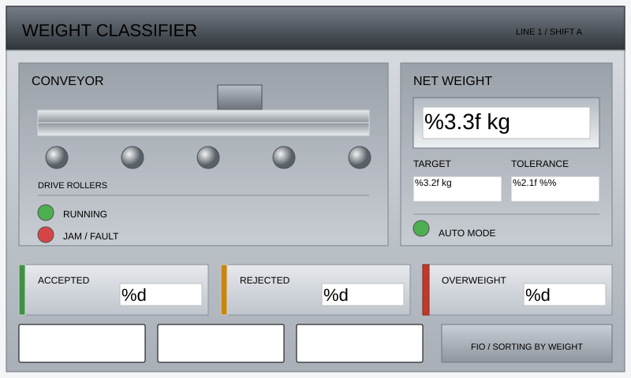
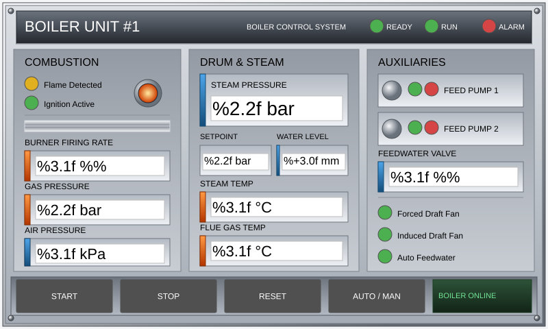
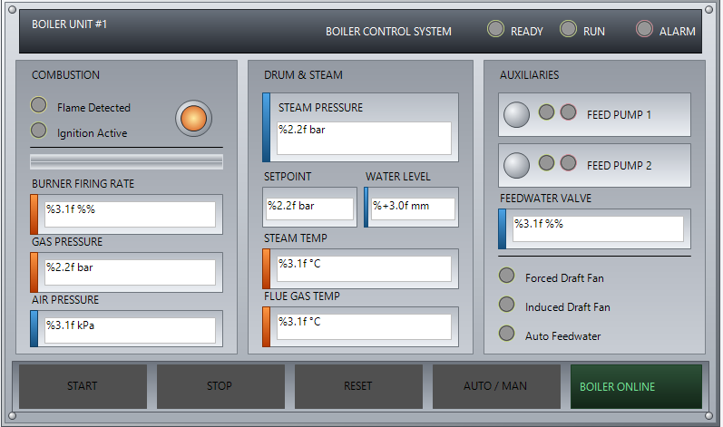

# HMI Screens from SVG (`cts visu`)

Draw the screen as an SVG sketch; `cts visu` compiles it into a CODESYS
visualization object. The sketch is the source of truth — it is text, so it
diffs, reviews and merges like the rest of the project.

This page is the walkthrough: what you need before you start, the whole chain
from an empty file to a screen open in CODESYS, and how the screen gets wired to
PLC variables. For exact flags run `cts visu <subcommand> --help`; for the authoring
contract an LLM is expected to follow, run `cts guide visu-svg` (it ships in the
package, so it always matches the installed CLI version).

---

## Before you start

- **The CODESYS CLI is installed**: use `cts.exe --help`. See [Installation](install.md).
- **`new`, `lint`, `preview` and `bind` need no project.** They read or write
  the sketch file. You can author and iterate offline, on a machine without
  CODESYS.
- **Screen commands need a project view.** `from-svg`, `to-svg`, `check`,
  `add`, `list`, `create-screen`, and `describe --screen` read or write screen
  XML in `project-view/`. The project must be linked with `cts set-sync-folder`
  and exported with `cts export`. See
  [Recommended workflow](../readMe.md#2-git-workflows).
- **Set a sync folder when needed.** Project-aware commands accept
  `--sync-folder <path>`; without it they search around the current directory.
  If no project view is found, they cannot resolve the theme or existing GVLs,
  or write the screen:

  ```powershell
  cts visu lint --svg line1.svg --sync-folder C:\path\to\sync
  ```

- **`--folder` is a CODESYS project-tree path.** Use the folder as shown by
  `cts project-tree`; it can be the application or a folder inside it.
- **`--create-screen` needs an existing object in that folder.** The new
  screen copies its placement from a sibling object, so create the HMI folder
  and add an object to it before compiling a new screen there.

---

## The whole chain

```powershell
cts visu new --name Line1 --w 1024 --h 600 --out line1.svg   # laid-out skeleton
cts visu lint --svg line1.svg --fix                          # design check, snaps the mechanical ones
cts visu lint --svg line1.svg                                # then read what is left
cts visu preview --svg line1.svg                             # .preview.svg + .preview.png — open the PNG
cts visu from-svg --svg line1.svg --create-screen --screen-name Line1 `
    --folder "Runtime/PLC Logic/Application/HMI" --gvl VisuVars
cts visu check --screen Line1                                # grade the compiled screen
cts import                                                   # project-view/ -> CODESYS
```

**The last line is the one people miss.** `from-svg` writes a visualization
`.xml` into `project-view/` — it does not touch the running IDE. The screen
reaches CODESYS the same way every other edit does, through
`cts import`. Until you run it, the screen exists on disk only.

In XML-first mode this works unchanged: a visualization's XML lives in the
tracked `project-view/`, so it reaches the IDE through the same `cts import`.

Recompiling later:

```powershell
# rebuild an existing screen in place
cts visu from-svg --svg line1.svg --screen Line1 --folder "Runtime/PLC Logic/Application/HMI"

# or rebuild it wholesale, keeping the object Guid so import updates
# the screen CODESYS already has instead of adding a second one beside it
cts visu from-svg --svg line1.svg --create-screen --screen-name Line1 --replace
```

`--screen` rebuilds that screen's elements. With `--create-screen`, an existing
screen name is refused unless `--replace` is set; replacement keeps its Guid.

---

## Binding to PLC variables

A screen that only draws is a picture. Three attributes make it live:

| Attribute | On | Binds |
| --- | --- | --- |
| `data-text-var="HMI.Temperature"` | `<text data-cds-type="textfield">` | the value displayed in the field |
| `data-cds-tap="HMI.StartPump"` | `<rect data-cds-type="button">` | the native button tap/toggle variable |
| `data-cds-action="OnMouseUp: screen CoolingTower"` | `<rect data-cds-type="button">` | a native input action — `TAP`, `TOGGLE`, `ST …`, screen change; several separated by `\|\|` |

Set them with `cts visu bind` instead of hand-editing the sketch — it patches
only these attributes on one element (by index, from `cts visu list --screen ...`
or the element's position in the file) and refuses anything that would touch
geometry:

```powershell
cts visu bind --svg line1.svg --elem 3 --text-var HMI.Temperature # data-text-var
cts visu bind --svg line1.svg --elem 5 --tap HMI.StartPump        # data-cds-tap
cts visu bind --svg line1.svg --elem 5 --action "OnMouseUp: screen CoolingTower"
cts visu bind --svg line1.svg --elem 5 --clear                    # remove all bindings
```

Draw first, bind second: finish the layout, `preview`/`lint` it with nothing
wired, then run `bind` on each interactive element as its own pass before the
final `from-svg --replace`.

Every variable a control references **must** be declared in a GVL. Let the
compiler write them:

```powershell
cts visu from-svg --svg line1.svg --screen Line1 --gvl VisuVars
cts visu from-svg --svg line1.svg --screen Line1 --gvl-file "project-view/Runtime/PLC Logic/Application/GVL_HMI.st"
```

`--gvl` collects every path found in `data-text-var`, `data-cds-tap` and
`data-cds-action`, and generates the missing declarations. Variables that
already exist in the project's GVLs are silently skipped, and if the sketch
binds nothing, no GVL file is written. Pass it on every compile of a sketch that
uses bindings — a screen wired to undeclared names does not build.

A path names its owner in the **first** segment: `GVL_Sensors.Scale.Q` is member
`Q` of instance `Scale`, and what `GVL_Sensors` declares is `Scale`. So
structured paths into an existing GVL need no new declaration; they reference
what is already there.

`cts visu lint` reports a control with nothing bound to it, which is how an
unwired field gets caught before the IDE sees it.

> [!NOTE]
> **A screen authored here is read-and-press.** Only buttons and plain shapes
> carry input actions — a textfield *displays* `data-text-var` and cannot be
> typed into. An operator can start, stop, toggle and navigate, but cannot key
> in a setpoint except through a button that writes one.

---

## Colours, styles and schemes

**You never write a colour.** An element carries `class="panel"`, `class="h1"`,
`class="pipe-water"`, and the palette resolves it against the CODESYS visual
style your project actually uses. The same sketch, with nothing else changed,
comes out light or dark.

`cts visu preview` renders the colours the compiler emits, before anything
reaches the IDE. Render your own; the two examples shipped in the package are a
good place to start — write one out with `cts guide visu-svg --file`:

```powershell
cts guide visu-svg --file examples/pid-schematic.svg > pid-schematic.svg
cts visu preview --svg pid-schematic.svg
cts visu preview --svg pid-schematic.svg --scheme dark
```

Three flags control the resolution, and `lint`, `preview` and `from-svg` all
accept them, so what you preview is what you compile:

- **`--theme flat-style|basic-style|white-style|default|style-2|…`** — the
  CODESYS visual style to resolve against. Default `flat-style`. Set it to
  whatever the project uses, or the preview lies to you.
- **`--scheme light|dark`** — default light. `cts visu new` records your choice
  on the sketch as `data-cds-scheme`, so the rest of the workflow needs no flag;
  elsewhere the flag overrides that attribute for a single run. In `dark` the
  curated palette owns surfaces, text and native control colours — every shipped
  CODESYS style is a light style — so `--theme` stops affecting them. Lamps keep
  their indicator colours in both.
- **`--background auto|style|#RRGGBB`** — `auto` (default) uses a curated
  neutral; `style` restores the visual style's own background.

Colour roles are defined in [`stylesheet.css`](../products/codesys-agent/src/Cts.Agent.Core/Visu/stylesheet.css)
and can be overridden per project with a `visu.css` in the project-view
directory.

---

## `lint` grades the sketch, `check` grades the compiled screen

**`lint`** catches what makes a valid screen look unfinished: off-grid
coordinates, text wider than its box, a font size outside the type scale, a
button too small to press, a field with nothing bound to it, a captionless
button, overlap, near-miss gaps. `--fix` splices the mechanical findings back at
their own character offsets, so comments and formatting survive byte-for-byte —
run it first, then read what is left, because those are the judgement calls.
`--strict` makes findings fatal instead of advisory (`from-svg` accepts it too).

**`check`** re-reads a screen that already exists in the project view and grades
it as CODESYS will: geometry, members, Text-IDs, colour links and overlaps. It
takes `--screen`, not `--name`.

**`preview`** is not a checker but belongs in the same loop. The sketch carries
no colours, so opening it in a viewer shows black shapes on white and tells you
nothing; `preview` renders it with the palette the compiler will actually emit,
as `<file>.preview.svg` + `.preview.png`. Open the PNG and look at it — is the
hierarchy readable, is anything visually lost. `--grid N` overlays an N-px grid;
`--no-png` writes only the SVG.

Rasterisation uses a headless Chrome/Edge when one is installed (`$CHROME_PATH`
overrides the search); without a browser the preview SVG is still written.

---

## Element vocabulary

`rectangle` (rect / ellipse / rounded-rect / line), `line`, `label`,
`textfield`, `button`, `lamp`, `combobox`, `image-switcher`, `alarm-banner`, and
captured `frame` instances. `cts visu types` prints the current list with
descriptions, and `cts visu describe --type <name>` explains one. An SVG tag
outside that vocabulary is refused by name rather than dropped silently.

A control is recognised by the **pair** — tag plus `data-cds-type`. Every
control is a `<rect>` except the textfield, which is a `<text>`. Put
`data-cds-type` on any other tag and it is not an error and not a control: it
falls through to the plain shape parser and you get a decoration that draws
correctly and does nothing. The one that catches people is the lamp — a circle
is the obvious shape for an indicator light, but `<circle data-cds-type="lamp">`
is just an ellipse. Draw the lamp as a square `<rect>`; the native bitmap is
round anyway. `lint` reports this as `control-tag`.

Not supported: polygon, polyline, image, transform, filters, masks,
animation, viewBox scaling, Table, TabControl, GroupBox, Checkbox. Linear and
radial gradients are supported on `rect`/`circle`/`ellipse` (see
[Colours, styles and schemes](#colours-styles-and-schemes)).

---

## All subcommands

| Command | What it does | Needs a project |
| --- | --- | --- |
| `new` | scaffold a laid-out SVG sketch for a canvas size | no |
| `lint` | design check on the sketch, `--fix` snaps the mechanical findings | no |
| `preview` | render the sketch with resolved colours to SVG + PNG | no |
| `from-svg` | compile the sketch into a screen `.xml` in the project view | yes |
| `to-svg` | decompile an existing screen back to a sketch | yes |
| `check` | validate a compiled screen | yes |
| `types` | list the element vocabulary | no |
| `describe` | describe a type and, optionally, an element of a screen (`--type NAME --screen NAME --elem N`) | for `--screen` |
| `create-screen` | create a new empty screen without going through SVG | yes |
| `bind` | patch only the binding attributes on one sketch element | no |
| `add` | add one element to a compiled screen | yes |
| `list` | list the elements of a compiled screen | yes |
| `capture-frame` | capture a `VisuFbFrame` instance as a golden template + catalog | yes |

`from-svg` also writes a preview SVG (and PNG when Chrome or Edge is available)
after a successful compile. Pass `--no-preview` to skip that render.

`add`, `list`, `create-screen` and `describe --elem` are element-level
operations on the compiled XML. They exist for surgical edits and for building a
screen without a sketch; the SVG route is the one to use by default, because the
sketch is what reviews in a PR.

---

## Letting an agent drive it

This is what the SVG contract is for. The shipped guide
[`cts guide visu-svg`](../products/codesys-agent/src/Cts.Agent.Core/Guides/visu-svg.md)
carries it whole — supported tags, the semantic classes, every CSS variable,
the colour rules, what is unsupported — together with the layout rules (the 4px
grid, page margin, bands, type scale, touch targets, the text-baseline rule),
the ordered workflow with the approval pause before compiling, two lint-clean
example sketches to imitate (reachable with `cts guide visu-svg --file
examples/…`) and the per-class text-box geometry, so an LLM agent with shell
access needs no other documentation to author a screen:

```powershell
cts guide visu-svg
```

`cts visu --help` lists the subcommands and `cts visu <subcommand> --help` their
flags. The Claude Code skill [`skills/cds-visu-svg/`](../skills/cds-visu-svg/)
is a thin wrapper that tells the agent to read it.

Two real runs, sketch on the left, the same screen after `from-svg` and an
actual import into the CODESYS IDE on the right — no manual touch-up either
side:

| Sketch (`cts visu new` → agent edits → `preview`) | Compiled and imported |
| --- | --- |
|  |  |
| Sonnet, medium effort | |
|  |  |
| gemini3.8flash, high effort | |

---

> [!NOTE]
> **Scope of verification.** The sketch-side workflow (`new`, `lint`, `preview`,
> and the SVG↔XML conversion both ways) is covered by the unit suite. On the
> compiled side, light output is pinned byte-for-byte across the `flat-style`,
> `basic-style` and `white-style` presets, and the dark colour encodings were
> settled by importing probe screens into a live IDE. What is *not* claimed is
> an exhaustive end-to-end sweep of every element and option against the
> CODESYS visualization editor — review a generated screen before you ship it,
> and please report what does not survive the import.
