# Development Workflow

This document explains the recommended team workflow for PLC development using **cds-text-sync**.

## Overview

The workflow is designed to combine the robustness of CODESYS for hardware configuration and HMI development with Git-based review of the XML-first exported view tree.



The steps below use the CODESYS-side `Project_*.py` entrypoints. The same
export / compare / import / build actions can also be driven from a shell with
the `cts` CLI once `Project_daemon.py` is running inside CODESYS (see
[`cds_text_sync/CLI.md`](../products/cds-text-sync/src/cds_text_sync/CLI.md)).

## 1. Project Initialization

Before the team can start working, the project must be prepared:

1.  **Set the project folder**: Run `Project_directory.py` and select the sync folder for the open project, or take the suggested `<project>-cts` folder beside the `.project` file. The default profile exports all supported `.st` and `.csv` text projections. Any command that needs a sync folder offers the same dialog, so this does not have to be the first one you run.
2.  **Choose advanced options if needed**: The options dialog opens by itself the first time a folder is configured — that is the moment to set XML-first/text-first mode, layout, profile, or text-export selection. The mode is fixed once the first export runs; switching later requires a new empty sync folder. `Project_options.py` reopens the dialog for everything but the mode.
3.  **Extract Project**: The initial state of the CODESYS project is exported using `Project_export.py`. This writes the current native snapshot to `.dump/IDE.xml` and refreshes the editable `project-view/` tree for review.
4.  **Choose Git Scope**: Track the `.project` file (through Git LFS) and the sync folder's `cds-text-sync.json` and `project-view/`; keep `.dump/` and the CODESYS session files out. [What goes into Git](#what-goes-into-git) lists every path and who commits it.
    A teammate's fresh clone therefore has no `.dump/manifest.json`. That is expected: on the first `Project_import.py` (or compare) the engine builds the manifest from the project open in CODESYS, then imports whatever the clone's files change — in either sync mode. Open the `.project` that matches the cloned commit (or the closest one you have) before importing.
5.  **Initialize Repository**: The owner creates the Git repository, commits the `.project` with the first export, and pushes it to a remote server (e.g., GitHub, GitLab, Forgejo).

### Text-first projects: what is tracked

In text-first mode the tracked surface is intentionally text:

- **Tracked**: `project-view/**/*.st` (and `.csv` projections), the native `.xml` of kinds kept in the view via `xml_in_view_kinds` (default: visualizations), and `cds-text-sync.json`.
- **Not tracked**: everything in `.dump/`, including the tool-owned `.dump/xml/` structural mirror. A teammate's fresh clone has no `.dump/` at all — `Project_import.py` rebuilds the manifest from the open IDE project and applies the `.st` files on top of it, and objects missing from the IDE are recreated from their text.
- Local `.st` edits are protected: export skips (or, interactively, asks before overwriting) any file changed on disk that has not been imported yet.

## 2. Team: one owner, several engineers

The scheme that needs no extra tooling: **one owner** keeps the `.project` file
and everything that only the IDE can edit safely (hardware, task and alarm
configuration, libraries); **engineers** change the logic as text in branches
and send it back through pull requests.

```
       owner                                         engineer (each clone)
 +------------------------------+   git pull     +------------------------------+
 | .project      (commits it)   | -------------> | .project      (never commits)|
 | sync folder   (all of it)    |                | sync folder   (logic only)   |
 | hardware, tasks, alarms, libs|                | "Not the project owner" on   |
 +------------------------------+                +------------------------------+
        ^  merge PR -> import -> export ->                  |
        |  commit .project + sync folder                    | pull request:
        +---------------------------------------------------+ sync folder only
```

| Role | Does | Commits |
| --- | --- | --- |
| **Owner** (one person) | Changes hardware, tasks, alarms and libraries in CODESYS; reviews and merges pull requests; imports merged logic into the `.project`. | `.project` and the whole sync folder, always together. |
| **Engineer** | Writes and fixes logic, in CODESYS or in an editor, on a branch. | Only the sync folder, and in it only what is not the owner's part. |

### What goes into Git

A repository with the `.project` file and its sync folder side by side (the
suggested `<project>-cts` folder):

```
Plant.project              # Git LFS; only the owner commits it
Plant-cts/
  cds-text-sync.json       # sync settings, shared
  project-view/            # the objects as files, shared
  .dump/                   # local work state, never committed
.gitattributes
.gitignore
```

| Path | Owner | Engineer |
| --- | --- | --- |
| `*.project` | commits, through Git LFS | takes the owner's copy; never commits it |
| `cds-text-sync.json` | commits | takes it as is |
| `project-view/`: logic (POUs, GVLs, DUTs, methods, visualizations) | commits | commits |
| `project-view/`: alarm and task configuration, library managers, hardware outside the application | commits | left out by "Not the project owner": not exported, not imported, not compared |
| `.dump/`, `.backup/`, `.diff/`, logs | local | local |
| `*.~u`, `*.opt`, `*.precompilecache`, `*.bootinfo`, `*.bootinfo_guids`, `*.compileinfo` | local (CODESYS session and build files) | local |

`.gitattributes`:

```gitattributes
*.project filter=lfs diff=lfs merge=lfs -text
```

`.gitignore`:

```gitignore
.dump/
.backup/
.diff/
*.~u
*.opt
*.precompilecache
*.bootinfo
*.bootinfo_guids
*.compileinfo
```

`.dump/` stays out completely: it is each clone's own record of what its IDE
and its files looked like at the last sync. A fresh clone builds it on the
first import. (The ".gitignore" option in `Project_options.py` keeps
`.dump/IDE.xml` and `.dump/manifest.json` tracked; in a team, use the rules
above instead.)

### The `.project` file

- The sync folder is stored in the `.project` file itself (Project Information,
  `cds-sync-folder`). Pick it with the folder browser inside the project's
  directory, so it is saved as a relative path (`Plant-cts`) and every clone
  finds its own copy. A path typed as absolute (`D:\work\Plant-cts`) only works
  on the machine it was typed on.
- Only the owner commits it, and always together with an export of the sync
  folder from the same project, so the two describe the same state.
- An engineer's CODESYS saves the `.project` too; that copy is a local working
  file. Stage the sync folder by name (`git add Plant-cts`), not `git add -A`.
  Before taking a new owner's copy, close CODESYS and drop the local one:
  `git restore Plant.project`.
- To make the rule hard, protect `main` and name the owner as the required
  reviewer of `*.project` (`CODEOWNERS` on GitHub, GitLab and Forgejo).

### Parts only the owner syncs

An engineer ticks **Not the project owner** on the Project tab of
`Project_options.py` (or runs `cts config non-owner on`) once per clone, after
the first import. From then on export, import and compare leave the owner's
parts alone, even though the owner committed their files: export neither writes
nor removes them, import does not apply them, and compare and the export's
dirty check do not report them. The sync log names how many objects were left
out. The engineer gets the owner's changes to these parts with the owner's
`.project`, not through import.

- The parts are found by their kind, not by name, so a project made in another
  IDE language works the same. Hardware that holds the application stays in
  the sync.
- The paths go into a marked block of the clone's own `.git/info/exclude`
  (never committed), and every command rewrites the block from the project, so
  a device the owner adds later is covered too. The sync folder has to be in a
  git work tree.
- To take the owner's version of these files once, untick the box, run
  `Project_import.py`, and tick it again.

The same mechanism reads any Git ignore rule (`.gitignore`, `.git/info/exclude`,
the global excludes file): an object is matched by its file in `project-view/`,
and a folder with everything inside it by a pattern ending in `/`. A rule that
covers the application, or an object but not what is below it, is refused
before anything is written. A rule in `.gitignore` applies to the owner as
well.

## 3. The Development Cycle

For every new task (feature or bug fix), an engineer follows these steps:

1.  **Start from the owner's state**: Close CODESYS, drop the local `.project`
    (`git restore Plant.project`), and `git pull` `main` or merge it into the
    branch. Open the `.project` and run `Project_import.py`: the branch's text
    goes into the owner's latest project.
2.  **Make Changes**: Implement the logic in CODESYS or in an editor.
3.  **Sync**: Run `Project_export.py` after work in CODESYS, or
    `Project_import.py` after work in an editor, so the IDE and the files agree.
4.  **Compare When Needed**: Run `Project_compare_ui.py` before committing to see what differs as a CODESYS dialog with full import/export actions; it also writes the machine-readable `.dump/compare_report.json`. From a shell or in CI, `cts compare` gives the same report without a dialog.
5.  **Commit & Push**: Commit the sync folder only (`git add Plant-cts`) to a
    **feature branch** and push it.
6.  **Create Pull Request**: Open a Pull Request (PR) to merge the feature branch into `main`.

## 4. Code Review & Integration

1.  **Review**: The owner reviews the changed files.
2.  **Approval**:
    - **Yes**: The branch is merged into `main`.
    - **No**: Feedback goes back, and the engineer returns to "Make Changes".
3.  **Into the project**: The owner pulls `main`, opens the `.project`, runs
    `Project_import.py` (the merged logic goes into the project), builds and
    checks it, runs `Project_export.py`, and commits the `.project` together
    with the sync folder.
4.  **Team Sync**: Engineers start their next task from step 1 of the cycle and
    get the owner's new `.project`.

Changes to the owner's parts never travel as files: the owner makes them in
CODESYS, exports, and commits the `.project` with the sync folder.
