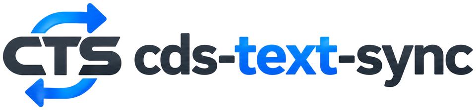
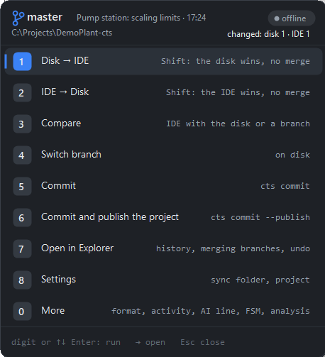
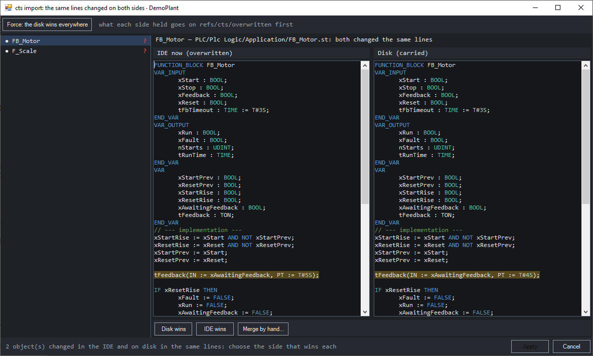
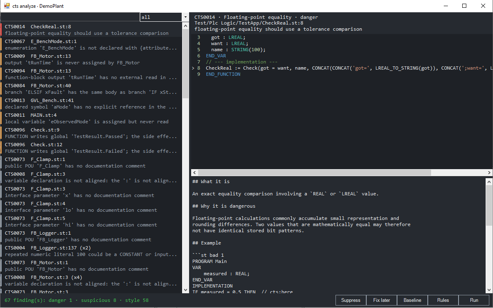
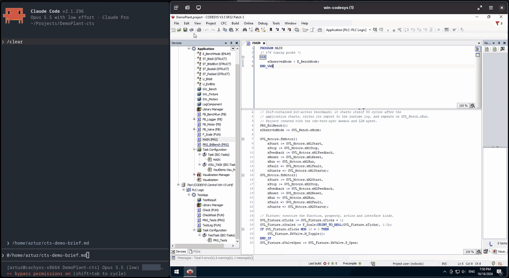
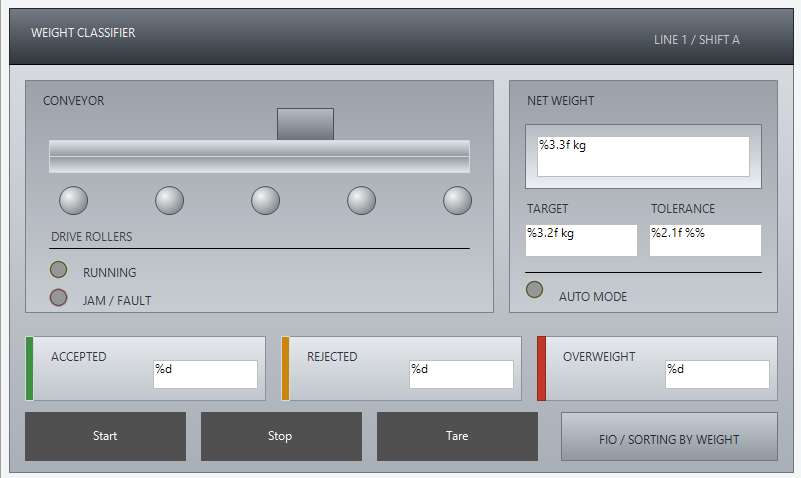

<p align="center">
  <picture>
    <source media="(prefers-color-scheme: dark)" srcset="img/cts-logo-dark.png">
    
  </picture>
</p>

<p align="center"><b>Your CODESYS project as text: Git, editors and AI agents work on it, the IDE stays in sync.</b></p>

# cds-text-sync

[](https://github.com/ArthurkaX/cds-text-sync/releases)
[](LICENSE)

Turn a binary CODESYS project into a folder that Git, editors, CI tools and
LLM agents can understand. Export the project, review or change its text on
disk, then import it back into CODESYS.

This is an independent MIT-licensed tool, not an official CODESYS product.

## 1. Quick start

Requirements: Windows 10 or 11, CODESYS V3.5 SP16 or newer
(tested on SP16 Patch 9 x86 and SP22 x64), and Git (the sync
folder is a Git repository; Git for Windows includes the Git LFS a team's
project file needs). `cts` and the in-IDE agent are .NET Framework 4.8
programs, which Windows 10 1903 and later include.

Install the tool and its CODESYS menu entry:

```powershell
irm https://raw.githubusercontent.com/ArthurkaX/cds-text-sync/main/irm/setup.ps1 | iex
```

> [!IMPORTANT]
> **4.0.** cds-text-sync is now `cts.exe` and an agent inside CODESYS;
> the `Project_*.py` scripts are gone. A 3.x sync folder is not taken over,
> and the last 3.x release, 3.4.1, stays one choice away in the installer's
> menu. [Upgrading to 4.0](docs/upgrade-4.md) lists what changes, what to
> delete and how to go back.

The `cds-text-sync` toolbar button
() starts the agent and opens the quick
window, just like **Tools > Scripting > Scripts > C > cds-text-sync**. The
installer places its script and icon in CODESYS's sibling **Script Commands**
folder and adds the button to Standard. If CODESYS was open during setup, close
it and run `cts install --toolbar`. For each project,
the important path is:

1. Open the project in CODESYS and start the agent once each time CODESYS
   starts: the toolbar button or **Tools > Scripting > Scripts > C >
   cds-text-sync** (or open the project with `cts project open --launch`).
   Nothing starts it on its own. Until it runs, Alt+Q does
   nothing and `cts` finds no IDE.
2. Press **Alt+Q**, then `8` Settings and `1` Sync folder. Enter takes the
   suggested folder (the clone the `.project` lies in, else `<project>-cts`
   beside it), or type your own (`cts set-sync-folder PATH` does the same).
   The project keeps only an id; each machine remembers its own folder for it,
   so a copy of the `.project` opened anywhere finds it again. That folder becomes a Git
   repository root on the spot: `git init` when it has none, ignore rules for
   generated files, and a first commit. Later the same row opens a folder
   dialog to move it; `8` also changes the key if Alt+Q is taken.

   Joining a project someone else set up: get its repository the way your
   team shares repositories (`git clone`), open the `.project` you were given
   (or the one the repository holds) and press Alt+Q. The window opens on this
   row and asks where your clone is; pick it once. A folder of another project
   is refused. The `.project` in the repository is the owner's (the machine that
   set the project up): only `cts commit --publish` there replaces it, and your
   commits carry the `.st` files, never a `.project`.
3. In the quick window, on a new folder press `2` (IDE -> Disk) to write the
   project to `project-view/`. The window shows the branch and what changed on
   each side.
4. Edit `project-view/`, then `1` (Disk -> IDE) carries the edits into the
   IDE, `3` compares (the disk or a branch), `5` commits, and `7` opens the
   folder in your git program (GitHub Desktop, VS Code, Zed: your choice in
   Settings) for merging branches and the history. From a shell the same steps are
   `cts export`, `cts import`, `cts compare`, `cts commit` and `cts open`.

<p></p>

`cts compare` shows what differs between disk, the IDE and the last sync before
either; `3` in the quick window opens the same difference in your diff program.
An object both sides changed is merged; when the edits overlap, `1` and `2`
open the conflict window first: each such object side by side, the lines that
differ marked, and for each **Disk wins**, **IDE wins** or **Merge by hand...**:

<p></p>

The quick window's Settings page covers the sync folder, the program
`7` opens, the quick key, this PC's role and the permissions; the files on disk
have no settings (one `.st` per POU, `.csv` for text lists). See the
[installation guide](docs/install.md) if the entry does not appear under
**Tools > Scripting**.

## 2. Git workflows

`project-view/` maps one-to-one onto the project: a POU, GVL, DUT or interface
is one `.st` file (methods, properties and actions inside), a text list is a
`.csv`, and devices, tasks, visualizations and other non-ST structure stay
native XML. `cts export` gives you both what Git can review and what CODESYS
can reimport; `cts import` carries a changed, new, renamed or removed file
back object by object.

The configured view root (`project-view/` by default) is the editable, Git
tracked tree; cts keeps its temporary files under `.git/cts/`, outside it. Keep
`project-view/` and `cds-text-sync.json` in commits. The sync base
(`refs/cts/base`) records what disk and IDE last agreed on, so `cts` can tell
which side changed. For a team, work on feature branches and have the project
owner review changes before merging to `main`; [Working as a team](docs/team.md)
walks through the owner's and a colleague's steps.

## 3. I want to find errors in my project

Export the project first, then run the analyzer against its `.st` files. It is
offline: no CODESYS window or PLC connection is required.

```powershell
cts analyze --workspace C:\path\to\sync-folder
cts analyze --workspace C:\path\to\sync-folder --sarif findings.sarif  # CI/code scanning
cts analyze rules
cts analyze explain CTS0007  # for example, indentation
```

In the IDE, quick window More, `5` Static analysis opens the findings window.

<p></p>

Details: [static analysis](docs/analyze.md).

### One command for "is this shippable?"

`cts verify` runs every applicable check — static analysis, SVG sketch lint,
and (if CODESYS is open) the compiler — and returns a single verdict with a
single exit code. The offline stages only read; the compiler stage touches IDE
build state and `--with-test` writes to the PLC, so those two are not read-only.

```powershell
cts --pretty verify --sync-folder C:\path\to\sync-folder
cts verify --with-test      # also run the .test/ plans on the PLC
```

`cts test` runs ST tests in simulation: a second device in simulation holds a
TestApp whose task tests the shared POUs, counts into a GVL `TestResult` and
logs each test to the runtime's log; every run saves that log as a file
(`cts guide tests`). The production application may stay online meanwhile.

A check that cannot run (no IDE open) is reported as `skipped` and marks the
run incomplete — it never turns into a failure. Exit codes: `0` pass, `1` real
problems, `2` could not start, `3` incomplete with `--incomplete error`.

<details>
<summary><strong>▶ Click to open: Quick ST formatting inside CODESYS</strong></summary>

When a Structured Text object looks untidy and opening the full Analyzer would
be unnecessary, open the format window: Alt+Q, `0` (More), `1` Format ST, or
quick window More, `1` Format ST. It aligns variable
declarations and repairs structural code indentation in the open IDE objects.

1. The list shows every Structured Text object of the project, those the
   formatter would change marked with their line count; the filter box narrows
   it.
2. The object chosen shows side by side, as the IDE has it and formatted, the
   changed lines marked on both sides; **Previous change** / **Next change**
   (Shift+F8 / F8) move between them.
3. **Apply** writes that object and goes on to the next one to fix; **Skip**
   goes on without writing; **Reload** (F5) reads the IDE again. An object
   edited since the list was read is refused rather than overwritten. Use the
   normal CODESYS Undo command to revert an applied change.

The same formatting runs from the shell: `cts fmt` lists what it would change,
`cts fmt NAME --write` applies it.

More details: [Script overview](docs/scripts.md#3-more-page-1-format-st-quick-st-formatting).
</details>

<details>
<summary><strong>▶ Click to open: FSM transition map</strong></summary>

If your code is built around state machines and you often have to read one
quickly — an unfamiliar `CASE`, or your own from six months ago — open the quick
window and choose More, `4` FSM map (Alt+Q, `0`, `4`). The agent's window lists the machines in the project's Structured Text
(unsaved edits included) and draws the one chosen as a GRAFCET diagram:
numbered steps, one bar per transition with its receptivity beside it, and a
step with several ways out fanned out as a divergence. Click a step or a
transition to read the Structured Text behind it. From the shell, `cts fsm`
lists the same machines, `cts fsm --disk` reads them from the exported files.

More details: [Script overview](docs/scripts.md#4-more-page-4-fsm-map-fsm-transition-map)
and `cts fsm --help`.
</details>

## 4. I want an LLM agent to control the project

Start the agent in CODESYS (the toolbar button or **Tools > Scripting >
Scripts > C > cds-text-sync**). It opens the quick window and exposes the
currently open project to the `cts` CLI. An agent can then export, inspect,
change, compare, import and build without clicking through the IDE:

```powershell
cts status                 # check the project, PLC and sync folder
cts set-sync-folder C:\path\to\sync --save  # configure it through the agent
cts set-sync-folder --save # or the suggested folder (the clone the .project lies in)
cts export                 # CODESYS -> project-view/
cts compare                # inspect IDE vs disk
cts import                 # project-view/ -> CODESYS
cts build                  # build the active application
cts analyze --workspace .  # offline check; no IDE required
cts verify                 # every applicable check, one verdict, one exit code
cts config show            # the quick window key and where it comes from
```

An LLM agent (left) working on the project open in CODESYS (right) through
`cts`: it edits a function block, adds a function, draws an HMI screen, builds,
downloads to the simulation, reads and writes live values, runs the analysis and
commits:

<p></p>

### Several IDEs at once: point the agent at one project

Each running CODESYS IDE is addressed as `ide-<pid>`. In that IDE, Alt+Q, `0`
(More), then `3` copies a ready line:

```
!cts --target ide-6128 --expect-project example_lib --help
```

Paste it into the agent's chat and it learns in one step which IDE and which project it should work with. Every later command carries the same
`--target` and `--expect-project`, so it cannot land in the wrong IDE, and it
refuses to write if someone has switched the IDE to another project. The
`--help` at the end prints the command list and where to start (`status`
with the same two flags shows that IDE's state). This is what lets two agents work on two projects in parallel, for
example an application and the library it uses. With more than one IDE open,
`cts` without `--target` goes to the IDE whose project's sync folder holds the
current folder (or the `--sync-folder` given); when none does, it refuses and
prints the available targets with their sync folders.

A library project has no application to compile. `cts build` checks it, and
`cts build --install` does what the IDE button "Save project and install into
library repository" does, so an agent can develop a library end to end.

The CLI also exposes project-tree operations, PLC interaction, tests and
diagnostics. Run `cts --help`, `cts <command> --help`, and `cts guide` for the
reference matching the installed version.

### Give an LLM agent the full picture of the project

An agent working on the project blind — with no visibility into its own POUs
or the library functions it calls — has to guess signatures or grep raw
sources. `cts docs` reads the exported project and the libraries it actually
references, offline, and writes what the agent needs to know without opening
the raw CODESYS sources:

```powershell
cts docs --workspace C:\path\to\sync
cts docs --libraries "C:\ProgramData\CODESYS"
cts docs --check          # 0 fresh, 1 stale, 2 no bundle
```

Output goes to `.cts-docs/`: `index.md` lists everything; `project/<Name>.md`
is one card per object — kind, doc comment, interface, inherited members,
its methods, properties and actions, what it calls, who calls it, the tasks
that run it and the globals it reads and writes; `libraries/<Name>-<Version>.md`
is one page per referenced library from its installed LibDoc (signature,
description, example, interface). `symbols.jsonl` holds every symbol as one
JSON line and `manifest.json` the counts and the missing LibDoc with the
reason. Only libraries the Library Manager references are documented, and only
in the referenced version. `.cts-docs/` is generated, so export/import/compare
ignore it and the `.gitignore` written when the sync folder is chosen covers
it; `--out` writes elsewhere.

Details: `cts docs --help`.

### Generate visualization screens from SVG

An agent can create an SVG sketch as plain text, lint and preview it, compile it
into a CODESYS visualization, and import the result through the in-IDE agent:

```powershell
cts visu new --name Line1 --w 1024 --h 600 --out line1.svg
cts visu lint --svg line1.svg --fix
cts visu preview --svg line1.svg
cts visu from-svg --svg line1.svg --create-screen --screen-name Line1 `
    --folder "PLC/Plc Logic/Application" --gvl VisuVars  # the folder as cts project-tree prints it
cts import
```



Details: [HMI screens from SVG](docs/visu.md).

## Documentation

- [Installation](docs/install.md)
- [Script overview](docs/scripts.md)
- [Project layout](#2-git-workflows)
- [Working as a team](docs/team.md)
- [CLI and operating guides](products/codesys-agent/src/Cts.Agent.Core/Guides/)
- [Static analysis](docs/analyze.md)
- [HMI screens from SVG](docs/visu.md)
- [Releases and rollback](docs/releases.md)
- [Upgrading to 4.0](docs/upgrade-4.md)

Issues, friction reports and feature requests are welcome in the [GitHub issue
tracker](https://github.com/ArthurkaX/cds-text-sync/issues). Everything posted
there is public: attach no project files or exports. Paste the output of
`cts diag`, run in the sync folder, instead: it holds versions, settings and
file counts, without file, object or project names. See the
[changelog](CHANGELOG.md) for release history.

MIT License.
